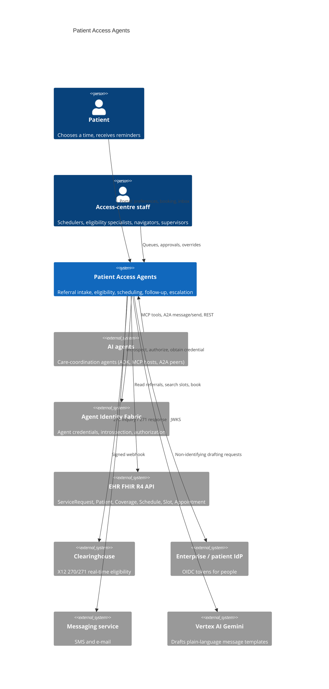
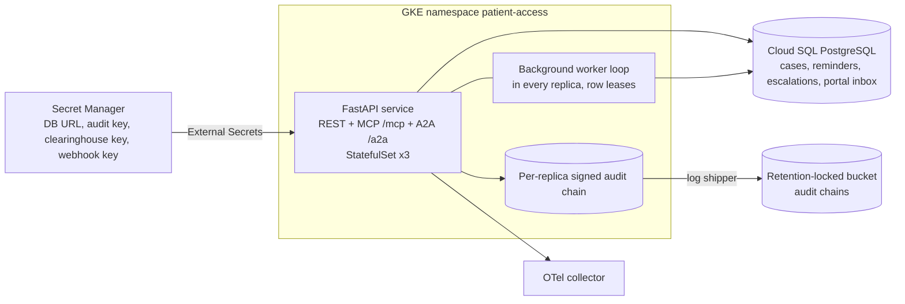
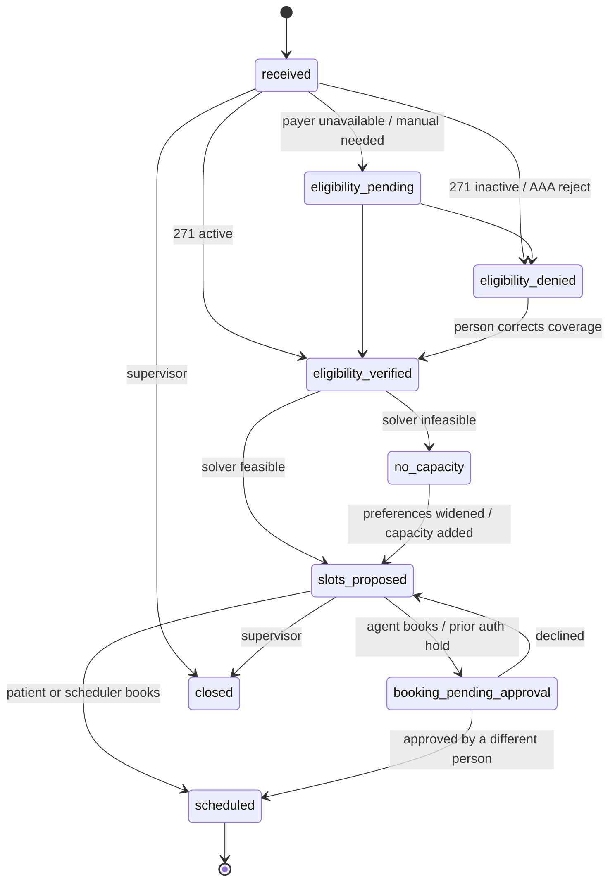
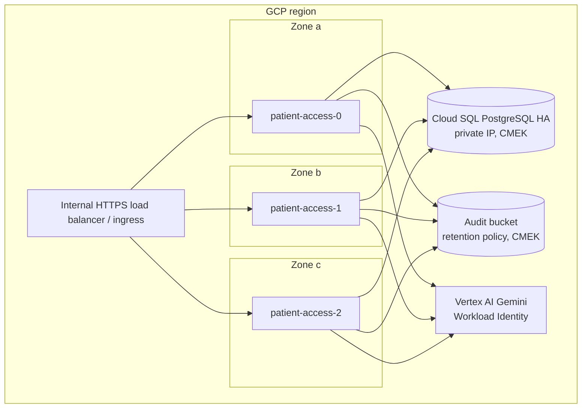

# Architecture

## Business problem

Specialty referrals leak. A primary-care physician sends a referral; somebody
in an access centre has to confirm the patient's insurance covers the
service, find a slot that fits the specialist's template, the patient's
availability and the clinical urgency, book it, remind the patient, and chase
anything that stalls. Every hand-off is a queue, and the referrals that fall
out are rarely the easy ones: a coverage rejection nobody followed up, a
patient who only has Saturday mornings, an urgent referral that waited a week
because the first available cardiologist was five weeks out.

This service puts agents on the routine path and people on the exceptions:

```
Referral ─▶ Eligibility Verification ─▶ Scheduling ─▶ Follow-Up Coordination ─▶ Escalation
(FHIR        (X12 270/271 via            (FHIR Slot      (reminders with           (human queues
ServiceRequest) clearinghouse)            constraint      retry, back-off,          with SLAs)
                                          solver)         quiet hours)
```

Agents never decide anything that should belong to a person: an eligibility
denial becomes a work item for an eligibility specialist, not a cancelled
referral; a booking requested by an agent waits for the patient or a
scheduler to approve it; a prior-authorization hold is cleared by eligibility
staff only.

## System context (C4 level 1)



## Containers (C4 level 2)



## Components (C4 level 3)

| Layer | Module | Responsibility |
|---|---|---|
| Interfaces | `api.routes`, `api.mcp`, `api.a2a`, `adapters.adk` | REST, MCP tools (official SDK, streamable HTTP), A2A Agent Card and JSON-RPC, Google ADK tool adapter |
| Application | `application.service.PatientAccessService` | Use cases: intake, route, eligibility, manual verification, slot proposal, booking and approval, reminders, SLA evaluation, escalation queue |
| Application | `application.eligibility`, `application.messaging`, `application.views` | 270/271 orchestration; model drafting with guard and template fallback; minimum-necessary projections |
| Domain | `domain.models`, `domain.rules`, `domain.scheduling`, `domain.timing` | Case state machine, operating rules, constraint solver, quiet-hours and back-off arithmetic |
| Integrations | `integrations.fhir`, `x12`, `clearinghouse`, `notifications`, `identity_fabric`, `gcp` | FHIR R4 client and mapping, X12 builder/parser, transports, fabric client, workload-identity tokens |
| Security | `security.authn`, `security.access`, `security.jwks` | Token verification for people and agents, policy decisions (agentic-core PolicyEngine + fabric), JWKS caching |
| Infrastructure | `infrastructure.database` | SQLAlchemy Core repositories, optimistic concurrency, leases, de-duplication |
| Runtime | `runtime.container` | Composition root built from `Settings` |

Shared controls come from [agentic-core](https://github.com/kogunlowo123/agentic-core):
`PolicyEngine`, `AuditLog` (hash-chained, Ed25519-signed), `ModelRouter` with
failover and circuit breakers, `ContentGuard`, structured logging and
OpenTelemetry.

## Case lifecycle



## Sequences

### Agent processes a referral (MCP or A2A)

```mermaid
sequenceDiagram
  participant A as Care-coordination agent
  participant P as Patient Access Agents
  participant F as Identity fabric
  participant E as FHIR server
  participant C as Clearinghouse
  A->>P: tools/call process_referral (Bearer agent credential)
  P->>F: introspect credential; authorize case:create
  P->>E: GET ServiceRequest, Patient
  P->>P: route codes to a service, compute SLA (audited)
  P->>E: GET Coverage, Organization (payer)
  P->>C: X12 270 (ISA..IEA, EQ service types)
  C-->>P: X12 271 (EB, AAA, DTP)
  P->>P: evaluate: active / inactive / reject / retry
  P->>E: GET Slot?specialty&start&_include (paged)
  P->>P: constraint solver ranks options
  P-->>A: case: slots_proposed + options
  A->>P: tools/call request_booking
  P->>P: policy: agent booking = require_approval
  P-->>A: pending_approval (escalation to scheduling queue)
```

### Person approves and the slot is booked

```mermaid
sequenceDiagram
  participant S as Scheduler
  participant P as Patient Access Agents
  participant E as FHIR server
  S->>P: POST /v1/cases/{id}/booking/decision approve
  P->>P: approver != requester; prior-auth holds need eligibility staff
  P->>E: Appointment?identifier=case (idempotency)
  P->>E: GET Slot (status, versionId)
  P->>E: PUT Slot status=busy, If-Match W/"v"
  P->>E: POST Appointment, If-None-Exist identifier=case
  P->>P: case scheduled; reminders planned (audited)
```

## Agent interfaces

### MCP

The official `mcp` SDK (2.x `MCPServer`, the successor of FastMCP) is
mounted at `/mcp` in stateless, JSON-response streamable-HTTP mode (ADR-0004).

| Tool | Input | Output | Authorization |
|---|---|---|---|
| `process_referral` | `service_request_id` | `CaseView` | `case:create`, `eligibility:verify`, `slots:search` |
| `get_case` | `case_id` | `CaseView` | `case:read` |
| `verify_eligibility` | `case_id` | `CaseView` | `eligibility:verify` |
| `propose_slots` | `case_id` | `SlotSearchView` | `slots:search` |
| `request_booking` | `case_id`, `proposal_id` | `BookingView` | `appointment:book` (agents: require_approval) |
| `list_escalations` | `queue?`, `status?` | `EscalationList` | `escalation:read` |

Each call authenticates the `Authorization` header, runs the same use case as
REST, and records an `mcp.tool` audit event. Errors return `isError` results
with the OAuth-style error code.

### A2A

`GET /.well-known/agent-card.json` publishes name, description, url,
version, capabilities, skills (`process-referral`, `case-status`) and a bearer
security scheme. `POST /a2a` accepts JSON-RPC `message/send`; the reply is a
`Task` whose state maps the case: `completed` (scheduled), `input-required`
(a person or the patient must act), `working` (eligibility retry pending),
`rejected` (forbidden or invalid state), `failed` (dependency failure).

### Google ADK

`adapters.adk.AdkToolset` exposes the same use cases as plain async
functions with docstrings, which ADK wraps with `FunctionTool`;
`build_adk_agent` assembles an `LlmAgent` on Gemini. Calls run as the agent
principal, so policy and approvals are identical.

## Observability

- Metrics (`/metrics`, own registry): request latency by route, case
  transitions, eligibility outcomes, slot options, bookings, reminder
  deliveries, composer fallbacks, escalations and open queue depth,
  authorization decisions, MCP/A2A calls, worker cycles.
- Alerts: `configs/prometheus/alerts.yaml` (error-budget burn, latency, SLA
  breaches, queue backlog, clearinghouse unavailability, reminder failures,
  deny spikes, model output rejections). Dashboard:
  `configs/grafana/patient-access-agents.json`.
- Traces: OpenTelemetry FastAPI instrumentation and GenAI semantic
  conventions for model calls (agentic-core `ModelTelemetryObserver`).
- Logs: JSON with correlation IDs; HTTP client loggers are held at WARNING so
  FHIR search URLs (which contain patient references) are not logged.

## Deployment pattern



Reference cloud is **GCP** (GKE + Cloud SQL + Secret Manager + Cloud KMS +
Cloud Storage + Vertex AI). `deployments/terraform/{aws,azure}` provide the
equivalent data plane on EKS/RDS/S3 Object Lock and AKS/PostgreSQL Flexible
Server/immutable Blob storage.

## CI/CD

`ci.yml` runs lint, format, `mypy --strict`, bandit, contract drift, the full
test pyramid on Python 3.12 and 3.13 with a 90% coverage gate, the workflow
and chaos suites against PostgreSQL, Helm lint/render/required-values check,
kubeconform, Terraform fmt/validate for three clouds, Trivy config and image
scans, Syft SBOM with a Grype gate, a container smoke test (readiness, Agent
Card, MCP `tools/list`, non-root user) and Semgrep. `release.yml` re-runs the
quality gate, checks the tag against package and chart versions, pushes the
image with provenance attestation, pushes the chart to GHCR OCI and creates a
GitHub release with an SBOM.

## Cost and scalability

- The hot paths are I/O-bound (FHIR, clearinghouse) and fully async; the HPA
  scales 3–10 replicas on CPU. Size with `tests/performance/locustfile.py`
  against staging before go-live rather than from estimates.
- Slot searches are bounded: one specialty, start window capped by the SLA
  deadline and a 90-day horizon, `_count=100`, at most 20 pages.
- Background work uses row leases, so adding replicas adds throughput
  without double-sending reminders.
- Model spend is small and bounded: one short drafting call per reminder,
  `max_tokens=300`, flash model on failover; costs per million tokens are
  configuration, not code, and every call reports estimated cost via the
  `agentic.model.cost` metric. With no model configured the service uses
  reviewed templates at zero model cost.
- Clearinghouse transactions are usually priced per inquiry; one inquiry per
  case plus bounded retries (5 attempts, back-off to 4 h).

## Data

| Store | Data | Classification | Retention |
|---|---|---|---|
| PostgreSQL `access_cases` | Referral summary (codes, priority, references), status history, eligibility result, proposals, appointment reference | RESTRICTED (PHI) | Per records policy (e.g. 7 years) |
| PostgreSQL `reminders`, `portal_messages` | Reminder schedule and delivery state; portal message bodies | RESTRICTED | 1 year after the appointment |
| PostgreSQL `escalations` | Work items with reason, queue, resolution | RESTRICTED | Life of case |
| Audit chains | Actor, action, resource, outcome, policy digest; no demographics | CONFIDENTIAL | 7 years, retention-locked |

Patient names, dates of birth and contact details are read from FHIR when
needed and never persisted by this service.

## Acceptance criteria

| # | Criterion | Evidence |
|---|---|---|
| AC1 | An active ServiceRequest becomes a case routed to a configured service; unknown codes escalate | `tests/unit/test_workflow.py::test_unroutable_referral_escalates_then_routes` |
| AC2 | Eligibility uses a valid 005010X279A1 270 and interprets 271 EB/AAA correctly | `tests/unit/test_x12.py` |
| AC3 | Denials, rejections, manual cases and prior-auth requirements escalate; nothing is auto-denied | `test_eligibility_outcomes_escalate_to_people` |
| AC4 | Proposed options satisfy provider, location, modality, availability, lead-time and deadline constraints | `tests/unit/test_scheduling.py` (property test) |
| AC5 | Agents cannot book without human approval; requesters cannot approve themselves | `test_agent_booking_requires_human_approval`, `tests/security` T7 |
| AC6 | Double booking is prevented by `If-Match` and conditional create | `test_stale_slot_is_detected_and_released` |
| AC7 | Reminders respect quiet hours, retry with back-off and escalate on exhaustion | `tests/chaos::test_messaging_outage_backs_off_then_escalates` |
| AC8 | Patients see only their own data; staff views are minimum necessary | `tests/security` T6, T13 |
| AC9 | Every decision and state change is in the signed audit chain | `tests/security` T10 |
| AC10 | MCP tools and A2A message/send drive the same workflow with the same controls | `tests/e2e/test_http_lifecycle.py` |
